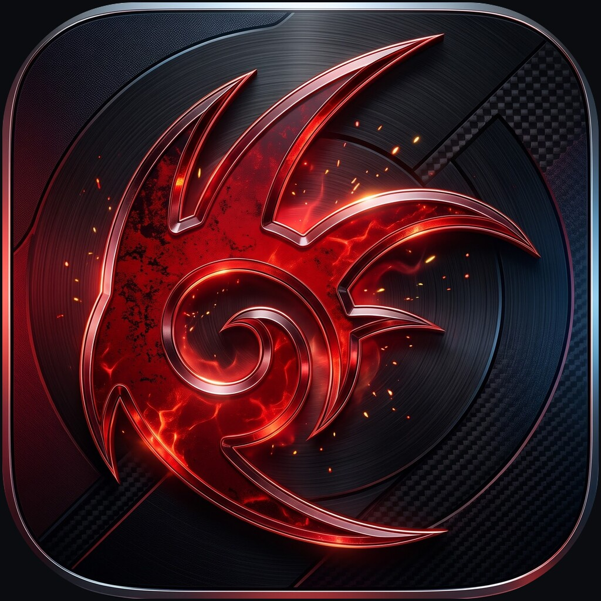

<div align="center">



# EdgyiOS
### *Shadow The Hedgehog Recompiled for iOS*

**Native iOS & iPadOS port (arm64 · Metal 3 · 120Hz ProMotion) developed by hiperema with Google AI Studio**

[](#compatible-devices)
[-dc2626?style=for-the-badge)](#how-it-was-developed)
[](#ios-exclusive-features)
[](#installation-on-iphone--ipad)
[](#legal--copyright-notice)

<p>
  <a href="#ios-exclusive-features">iOS Features</a> •
  <a href="#compatible-devices">Compatible iPhone &amp; iPad</a> •
  <a href="#how-it-was-developed">How It Was Developed</a> •
  <a href="#github-resources--credits">GitHub Resources &amp; Credits</a> •
  <a href="#cloud-build-no-mac-required">No-Mac Cloud Build</a> •
  <a href="#installation-on-iphone--ipad">Installation</a> •
  <a href="RELEASE_NOTES.md">Release v1.0.0</a> •
  <a href="LEGAL.md">Legal &amp; Licensing</a>
</p>

</div>

---

## Overview

**EdgyiOS: Shadow The Hedgehog Recompiled for iOS** is a native iOS and iPadOS port of the open-source static recompilation project [FoxWorkshop/ShadowRecomp](https://github.com/FoxWorkshop/ShadowRecomp), engineered to run *Shadow the Hedgehog (2005)* at full native Apple Silicon speed without JIT emulation and without requiring a Mac to build.

Unlike traditional emulators, static recompilation translates the original Xbox executable directly into native **arm64 C++** and compiles its shaders into **SPIR-V / Metal 3** via MoltenVK. The result is a fast, responsive native iOS app capable of up to **120 FPS** on ProMotion displays, featuring custom mobile enhancements: a vector Shadow-themed virtual controller with CoreHaptics, cross-platform 2-Player Hotspot/Wi-Fi multiplayer, Dual-Screen AirPlay & HDMI TV Mode, and automatic 6-language localization.

> **Important — Zero Copyrighted Assets:** Neither this repository nor the generated `.ipa` contains any copyrighted game assets, textures, audio, video, or proprietary SEGA/Sonic Team game code. To play, you must supply files extracted from **your own legally purchased copy** of *Shadow the Hedgehog (2005)* for the original Xbox using the iOS Files app. See [LEGAL.md](LEGAL.md) for full details.

---

## iOS Exclusive Features

### 1. Native arm64 Performance, Metal 3 & 120Hz ProMotion
- **100% Native Execution (Zero JIT):** Runs on stock, non-jailbroken iOS via both standalone sideloading (**Feather**) and containerized execution (**LiveContainer**, built with `-fPIC -Wl,-pie`).
- **True Native Full-Screen Resolution:** Configured with `UILaunchScreen` and universal `UIDeviceFamily` (iPhone + iPad) to render edge-to-edge at native display resolution (e.g., `2622×1206` on iPhone 16 Pro) with zero letterboxing or stretched scaling.
- **120Hz ProMotion Ready:** Enables `CADisableMinimumFrameDurationOnPhone`, zero-overhead overlay compositing (`allowsGroupOpacity = NO`), and a lock-free input ring buffer for smooth 120 FPS gameplay.
- **Extended Memory & Safe GPU Lifecycle:** Ships with `increased-memory-limit` and `extended-virtual-addressing` entitlements, plus synchronous Metal queue draining (`vkQueueWaitIdle`) on lock-screen/app-switch and automatic Vulkan swapchain recovery on resume.

### 2. Shadow-Themed Xbox Original Virtual Controller
- **Crisp Vector UI (CoreGraphics / QuartzCore):** Translucent obsidian-glass styling with crimson accents, a 3D-tilt & pressure-sensitive Shadow Emblem left stick, camera right stick, sliding 8-way D-Pad, classic Xbox ABXY cluster, analog `LT/RT` triggers, `LB (White)`, `RB (Black)`, `L3`, `R3`, `Start`, and `Back`.
- **CoreHaptics Taptic Engine Feedback:** Calibrated mechanical press/release clicks, analog stick detents, and native forwarding of in-game Xbox rumble (`XboxVibrationPacket`) to the iPhone Taptic Engine.
- **Chaos Emerald Quick-HUD:** Center Chaos Emerald button with dynamic **Hero / Neutral / Dark** aura that toggles a compact Quick-HUD bar featuring:
  - **Opacity** adjustment (`25%–95%`, persisted via `NSUserDefaults`);
  - **Haptics** toggle (ON/OFF);
  - **Auto-Hide 4s** (fades controls out after 4 seconds of inactivity and wakes instantly on touch);
  - **TV Mode** toggle (AirPlay / HDMI);
  - **2-Player Multiplayer** toggle;
  - **LOG** diagnostic recorder (10-second live telemetry & engine capture saved to `ShadowRecomp/crashlog.txt`).
- **Automatic Physical Controller Detection:** Connecting any Bluetooth or USB-C controller (DualSense, Xbox Wireless, Backbone, MFi) automatically hides the touch overlay for an unobstructed view.

### 3. Cross-Platform 2-Player Multiplayer (Personal Hotspot & Local Wi-Fi)
- **Built-In Local HTTP + WebSocket Server:** Powered by Apple `Network.framework` (`nw_listener_t`, port `8765`, `TCP_NODELAY`), automatically detecting Personal Hotspot (`bridge100` / `172.20.10.1`) or local Wi-Fi with zero internet required and zero impact on 120 FPS performance.
- **Instant Pairing:** Tap the **2-Player** button in the Chaos Emerald bar to reveal the **Pairing** pill. Tapping it displays a native **QR Code** (`CoreImage`) and automatically copies the local link to your clipboard (with background keep-alive so you can paste it in Messages/WhatsApp without dropping the server).
- **Android & iPhone Web Controller:** Smartphone 2 opens the local link in any mobile browser to get a full-screen, oversized, blind-playable virtual controller styled to match the native iOS gamepad, complete with vibration feedback and live connection status.
- **Smart Auto-Hide Status Pill:** Once Player 2 connects, the pill switches to **Connected** and automatically fades away after 3.5 seconds to keep the screen clean, reappearing with an alert only if Player 2 disconnects.
- **Native Player 2 Injection:** Works in both **2P Battle Mode** and story stages where Player 2 controls Sonic and friends.

### 4. Dedicated Dual-Screen TV Mode (AirPlay & HDMI)
- **Automatic External Display Detection:** The **TV** button next to the 2-Player icon activates automatically whenever your iPhone or iPad is connected via **AirPlay** or **HDMI**.
- **Clean Full-Screen Game on TV, Dedicated Gamepad on iPhone:**
  - The **TV** displays **only** the pure full-screen Metal game surface — **zero virtual buttons or HUD overlays appear on the TV** (overscan compensation disabled, smart 1080p cap to prevent Jetsam OOM on 4K TVs).
  - Your **iPhone** transforms into a sleek dark gamepad with **oversized blind-playable controls**, full CoreHaptics feedback, and simultaneous 2-Player Multiplayer support.
- **Freeze-Free Lock Screen & App-Switch Recovery:** Locking your iPhone or switching apps during TV Mode cleanly parks Metal and detaches the external window, then rebuilds a fresh TV window and MoltenVK swapchain automatically upon return (or seamlessly returns the game to your iPhone if AirPlay/HDMI was disconnected).

### 5. Automatic System Language Detection (6 Languages)
- Automatically detects your device's language at launch (`[NSLocale preferredLanguages]`) with zero mixed-language labels across the HUD, Quick-Bar, 2P pairing card, TV Mode notifications, native iOS Files picker, and installer credits (*"iOS port developed by hiperema"*).
- Smartphone 2's web controller independently adapts to its own browser language (`navigator.language`).
- **Supported Languages:** English (universal fallback), Italian, Spanish, French, German, and Japanese.

### 6. Built-In Crashlog & 10-Second Diagnostic Recorder (`crashlog.txt`)
- **Automatic Crash & Memory-Warning Capture:** Intercepts native iOS crashes (`SIGSEGV`, `SIGBUS`, `SIGABRT`, `SIGILL`, `SIGFPE`, `SIGTRAP`, `NSException`, `std::terminate`) and low-memory warnings with zero impact on 120 FPS gameplay, automatically writing timestamps, ARM64 stack traces, RAM usage, and recent engine/SDL3 logs to **`On My iPhone → EdgyiOS → ShadowRecomp/crashlog.txt`**.
- **On-Demand 10s `LOG` Button:** Tap **`LOG`** (right next to the 2-Player button in the Chaos Emerald bar) whenever you spot a glitch, stutter, or bug to record 10 seconds of live FPS, RAM, thermal state, and engine/SDL3 events directly into `crashlog.txt` — ready to attach to a GitHub Issue!

### 7. Native iOS Files Integration, Mod Manager & Custom App Icon
- **Full-Screen iOS Files Picker:** Native `UIDocumentPickerViewController` bridge (`asCopy`) plus automatic scanning of local files placed in *On My iPhone → EdgyiOS*.
- **Built-In iOS Mod Manager:** Native UIKit interface compatible with ShadowRecomp's `ModLoader::Init()` (`mods/.modloader/profiles/Default.json`).
- **Compiled App Icon (`Assets.car`):** Opaque iPhone and iPad icons compiled via `actool` for sharp display on SpringBoard (Feather) and inside LiveContainer.

---

## Compatible Devices

Minimum OS Requirement: **iOS 17.0+ / iPadOS 17.0+** · **arm64** (Apple Silicon / A-series).

### Compatible iPhones

| Tier | iPhone Models | Chip | RAM | Expected Experience |
| :--- | :--- | :--- | :---: | :--- |
| **Optimal (120Hz ProMotion)** | **iPhone 17 / 17 Air / 17 Pro / 17 Pro Max**<br>**iPhone 16 Pro / 16 Pro Max**<br>**iPhone 15 Pro / 15 Pro Max** | A19 / A19 Pro<br>A18 Pro<br>A17 Pro | 8–12 GB | Native **120 FPS**, full display resolution, smooth TV Mode & 2P Multiplayer, ample RAM headroom |
| **Excellent (60Hz–120Hz)** | **iPhone 16 / 16 Plus / 16e**<br>**iPhone 15 / 15 Plus**<br>**iPhone 14 Pro / 14 Pro Max**<br>**iPhone 13 Pro / 13 Pro Max** | A18<br>A16 Bionic<br>A16 Bionic<br>A15 Bionic | 6–8 GB | **60–120 FPS** (120Hz on Pro models), high stability with `increased-memory-limit` |
| **Good (60Hz)** | **iPhone 14 / 14 Plus**<br>**iPhone 13 / 13 mini**<br>**iPhone 12 Pro / 12 Pro Max**<br>**iPhone SE (3rd gen)** | A15 Bionic<br>A15 Bionic<br>A14 Bionic<br>A15 Bionic | 4–6 GB | Smooth **60 FPS** (closing background apps is recommended on 4 GB models) |
| **Basic Support (60Hz)** | **iPhone 12 / 12 mini**<br>**iPhone 11 / 11 Pro / 11 Pro Max**<br>**iPhone XS / XS Max / XR**<br>**iPhone SE (2nd gen)** | A14 Bionic<br>A13 Bionic<br>A12 Bionic<br>A13 Bionic | 3–4 GB | Boots on iOS 17+; 3 GB devices (XR / SE 2nd gen) may hit iOS Jetsam limits in heavy stages |

### Compatible iPads

| Tier | iPad Models | Chip | RAM | Expected Experience |
| :--- | :--- | :--- | :---: | :--- |
| **Optimal (120Hz ProMotion)** | **iPad Pro 11" / 13" (M4)**<br>**iPad Pro 11" / 12.9" (M2 / M1)**<br>**iPad Pro (2018 / 2020)** | M4 / M2 / M1<br>A12X / A12Z | 4–16 GB | **120 FPS** on ProMotion displays, plug-and-play USB-C HDMI TV Mode |
| **Excellent (60Hz)** | **iPad Air 11" / 13" (M3 / M2 / M1)**<br>**iPad mini (A17 Pro / 6th gen)**<br>**iPad Air (4th gen)** | M3 / M2 / M1<br>A17 Pro / A15<br>A14 | 4–8 GB | Rock-solid **60 FPS**, spacious screen ideal for physical controllers or touch |
| **Basic Support (60Hz)** | **iPad (11th gen A16 / 10th gen A14 / 9th gen A13)**<br>**iPad Air (3rd gen)** · **iPad mini (5th gen)** | A16 / A14 / A13 / A12 | 3–6 GB | Supported on iPadOS 17+; avoid heavy texture mods on 3 GB RAM models |

> **RAM & Sideloading Note:** Devices with **6 GB RAM or higher** deliver the best experience. Signing with a certificate that preserves `com.apple.developer.kernel.increased-memory-limit` (or running inside LiveContainer) gives MoltenVK and game assets significantly more memory headroom.

---

## How It Was Developed

**EdgyiOS** was developed by **hiperema** using **Google AI Studio** to architect the native iOS compatibility layer, automate upstream C++/Objective-C++/CMake patching, engineer the custom virtual gamepad / 2P server / TV Mode subsystems, and maintain the zero-Mac GitHub Actions CI pipeline and automated test suite.

### Technical Architecture (Zero-Mac Cloud Pipeline)
```text
[GitHub Actions macOS-15 Host Runner]
  ├── XboxRecomp2 (Rust)  ──► Static recompilation: Original Xbox x86 -> Native arm64 C++
  ├── XShaderRecomp + DXC ──► Shader translation: Xbox shaders -> SPIR-V
  └── file_to_c           ──► Embedded ShadowRecomp UI & font resources
                │
                ▼
[iOS arm64 Cross-Compilation (CMake + Ninja + Xcode iOS SDK)]
  ├── ShadowRecomp + Plume (Vulkan) ──► MoltenVK (libMoltenVK.a) ──► Apple Metal 3
  ├── SDL3 Static (AirPlay-safe UIKit + CoreAudio + GameController)
  ├── EdgyiOS Native Layer (com.hiperema.edgyios.ios):
  │     ├── ios_virtual_controller.mm (CoreGraphics + CoreHaptics + TV Mode + 6 Languages)
  │     ├── ios_p2_server.mm          (Network.framework HTTP/WS + Cross-Platform 2P Webpad)
  │     ├── nfd_ios.mm                (Full-Screen UIDocumentPicker iOS Files Bridge)
  │     ├── ios_mod_manager.mm        (UIKit ModLoader profiles.json Manager)
  │     └── ios_platform.mm           (os::logger/process/media + Safe Metal GPU Lifecycle)
  └── ldid Entitlements + Assets.car ──► EdgyiOS-iOS.ipa (Unsigned, Zero Game Assets)
```

---

## GitHub Resources & Credits

**EdgyiOS** stands on the shoulders of the open-source community. Full credit to every upstream project and resource used:

| Project / Resource | Role in EdgyiOS | License / Reference |
| :--- | :--- | :--- |
| **[FoxWorkshop/ShadowRecomp](https://github.com/FoxWorkshop/ShadowRecomp)** | Upstream static recompilation project for *Shadow the Hedgehog* (including `XboxRecomp2`, `XShaderRecomp`, and `Plume`) | Upstream Open-Source |
| **[DevZer0D4Y/MarathonRecompilediOS](https://github.com/DevZer0D4Y/MarathonRecompilediOS)** | Architectural inspiration for Zero-Asset iOS cloud builds, iOS Files workflow, and Mod Manager | Upstream Open-Source |
| **[KhronosGroup/MoltenVK](https://github.com/KhronosGroup/MoltenVK)** | Vulkan / SPIR-V → Apple Metal 3 runtime for iOS arm64 | Apache-2.0 |
| **[libsdl-org/SDL](https://github.com/libsdl-org/SDL)** | SDL3 UIKit backend (windowing, CoreAudio, GameController) | zlib License |
| **[FreeType](https://freetype.org/)** | Static iOS arm64 font rasterizer required by `msdf-atlas-gen` | FreeType License / GPL |
| **[ocornut/imgui](https://github.com/ocornut/imgui)** | Installer wizard and in-game overlay UI framework | MIT License |
| **[ProcursusTeam/ldid](https://github.com/ProcursusTeam/ldid)** | Ad-hoc entitlement signing (`increased-memory-limit`, `extended-virtual-addressing`) in CI | BSD-style Open-Source |
| **[khcrysalis/Feather](https://github.com/khcrysalis/Feather)** | Tested & supported standalone iOS sideloader | Open-Source |
| **[LiveContainer/LiveContainer](https://github.com/LiveContainer/LiveContainer)** | Tested & supported containerized iOS runner (`-fPIC -Wl,-pie`) | Apache-2.0 |
| **Google AI Studio** | Co-development environment used by **hiperema** to build, iterate, and verify the iOS port | Development Tool |

---

## Cloud Build (No Mac Required)

You do not need a Mac to build **EdgyiOS**. Everything compiles on **GitHub Actions (`macos-15`)** without ever committing game files to Git (`.gitignore` automatically blocks `*.xbe`, `*.iso`, `*.xiso`, `*.afs`, `*.one`, `*.txd`, and `private/`).

1. Fork or clone this repository on GitHub.
2. Open **Settings → Secrets and variables → Actions → New repository secret**.
3. Create an encrypted secret named **`DEFAULT_XBE_URL`** pointing to a temporary/private direct download link of the `default.xbe` extracted from **your own legal copy** of the game (~4.8 MB).
   - The file is downloaded solely inside the ephemeral `macos-15` runner during `XboxRecomp2` code generation and destroyed immediately after the build finishes.
4. Go to **Actions → Build EdgyiOS Unsigned IPA → Run workflow**.
   - Select `Release` (recommended).
   - *(Optional)* Enable **`publish_release`** to automatically create a GitHub Release with `EdgyiOS-iOS.ipa` and `SHA256SUMS-EdgyiOS.txt`.
5. Download the generated `.ipa` artifact directly onto your iPhone or iPad.

---

## Installation on iPhone & iPad

### Option A — Feather (Standalone)
1. Import `EdgyiOS-iOS.ipa` into **Feather**, sign with your certificate, and install.
2. Launch **EdgyiOS**: the installer wizard opens the native **iOS Files** picker so you can select your extracted game folder or `.iso` / `.xiso` *(or pre-copy it into On My iPhone → EdgyiOS)*.
3. Once installation completes, restart the app and enjoy!

### Option B — LiveContainer
1. Import `EdgyiOS-iOS.ipa` into **LiveContainer** (the binary is pre-compiled with `-fPIC -Wl,-pie` for full compatibility).
2. Launch **EdgyiOS**, pick your legally dumped game files via iOS Files, and restart once installation finishes.

---

## Legal & Copyright Notice

- **Zero copyrighted assets** are included in this repository, its source code, or any compiled `.ipa`.
- **EdgyiOS** is an independent, non-commercial, fan-made port and is **not affiliated with, endorsed by, or sponsored by** **SEGA CORPORATION**, **Sonic Team**, **Microsoft Corporation**, or **Apple Inc.**
- All trademarks (*Shadow the Hedgehog*, *SEGA*, *Xbox*, *iPhone*, *iPad*, *iOS*, *AirPlay*, *Metal*) are the property of their respective owners.
- Using this project requires owning a legitimate original copy of *Shadow the Hedgehog (2005)* for Xbox. Requests for or links to ROMs, ISOs, or `.xbe` files are strictly prohibited.

Please read **[LEGAL.md](LEGAL.md)** for the complete legal notice, AI development disclosure, third-party licenses, and takedown policy.

---

<div align="center">
  <sub>iOS Port developed by <strong>hiperema</strong> · Co-developed with <strong>Google AI Studio</strong> · Built upon <strong>FoxWorkshop/ShadowRecomp</strong></sub>
</div>
